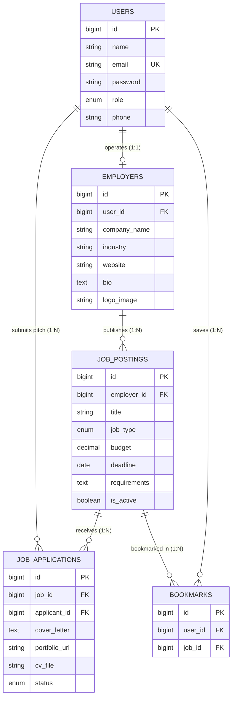

# EF234301 Web Programming (D) — Midterm Project Report
**Project Title**: 3. Freelance Job Board & Candidate Application Portal (Ascend Gigs)  
**Architecture**: Laravel 11 MVC (Model-View-Controller) PHP 8.3.33 & SQLite / MySQL  
**GitHub Repository**: https://github.com/PopSharkkk/WebProgramming  
**Local Staging URL**: http://127.0.0.1:8000  

---

## 1. Executive Summary & Domain Overview
The **Ascend Freelance Job Board & Candidate Application Portal** is a dual-sided micro-recruitment hub connecting local businesses and campus student organizations with student freelancers (designers, coders, writers, tutors).

Built with Laravel 11 MVC, it features an interactive Three.js WebGL hero, responsive glassmorphic Blade views, secure role-based session authentication, file-handling pipelines for PDF CV uploads and employer logo branding, a multi-criteria search and filtering engine, and real-time application status tracking.

---

## 2. Database Design (20 Points)

### 2.1 Conceptual Data Model (CDM)
The conceptual model abstracts business entities and relationships:
- **`USERS`**: Core identity for both student freelancers and employer hiring managers (`id`, `name`, `email`, `role`, `phone`).
- **`EMPLOYERS`**: Studio/Organization entity linked 1:1 to a User (`id`, `user_id`, `company_name`, `industry`, `website`, `bio`, `logo_image`, `social_media_links`).
- **`JOB_POSTINGS`**: Vacancies published by Employers (`id`, `employer_id`, `title`, `job_type`, `budget`, `deadline`, `requirements`, `description`, `is_active`).
- **`JOB_APPLICATIONS`**: Candidate pitches and uploaded PDF CV resumes connecting Applicants to Gigs (`id`, `job_id`, `applicant_id`, `cover_letter`, `portfolio_url`, `cv_file`, `status`).
- **`BOOKMARKS`**: Watchlist records pairing Users with Job Postings (`id`, `user_id`, `job_id`).

### 2.2 Physical Data Model (PDM) & Relational Schema
The physical relational schema implements strict SQL types, cascade delete triggers, and unique constraints:

| Table | Column | Type & Modifiers | Key / Constraint | Description |
|---|---|---|---|---|
| **users** | `id` | BIGINT UNSIGNED AUTO_INCREMENT | PRIMARY KEY | User unique ID |
| | `name` | VARCHAR(255) NOT NULL | - | Full name |
| | `email` | VARCHAR(255) NOT NULL | UNIQUE | Login credential |
| | `password` | VARCHAR(255) NOT NULL | - | Hashed password |
| | `role` | ENUM('freelancer', 'employer') | DEFAULT 'freelancer' | RBAC role |
| | `phone` | VARCHAR(255) NULL | - | Contact phone |
| **employers** | `id` | BIGINT UNSIGNED AUTO_INCREMENT | PRIMARY KEY | Employer unique ID |
| | `user_id` | BIGINT UNSIGNED NOT NULL | FK -> `users(id)` | Cascade delete link |
| | `company_name` | VARCHAR(255) NOT NULL | - | Company name |
| | `industry` | VARCHAR(255) NOT NULL | - | Industry sector |
| | `website` | VARCHAR(255) NULL | - | Website URL |
| | `bio` | TEXT NULL | - | Company bio |
| | `logo_image` | VARCHAR(255) NULL | - | Uploaded logo path |
| | `social_media_links` | VARCHAR(255) NULL | - | Social media links |
| **job_postings** | `id` | BIGINT UNSIGNED AUTO_INCREMENT | PRIMARY KEY | Job unique ID |
| | `employer_id` | BIGINT UNSIGNED NOT NULL | FK -> `employers(id)` | Cascade delete link |
| | `title` | VARCHAR(255) NOT NULL | - | Vacancy title |
| | `job_type` | ENUM('Remote', 'On-site', 'Hybrid') | DEFAULT 'Remote' | Work mode |
| | `budget` | DECIMAL(10,2) NOT NULL | - | Stipend amount |
| | `deadline` | DATE NOT NULL | - | Expiry deadline |
| | `requirements` | TEXT NOT NULL | - | Skills deliverables |
| | `description` | TEXT NULL | - | Project background |
| | `is_active` | BOOLEAN NOT NULL | DEFAULT TRUE | Visibility toggle |
| **job_applications** | `id` | BIGINT UNSIGNED AUTO_INCREMENT | PRIMARY KEY | Application ID |
| | `job_id` | BIGINT UNSIGNED NOT NULL | FK -> `job_postings(id)` | Cascade delete link |
| | `applicant_id` | BIGINT UNSIGNED NOT NULL | FK -> `users(id)` | Cascade delete link |
| | `cover_letter` | TEXT NOT NULL | - | Pitch narrative |
| | `portfolio_url` | VARCHAR(255) NULL | - | Portfolio link |
| | `cv_file` | VARCHAR(255) NULL | - | Uploaded PDF path |
| | `status` | ENUM('Pending', 'Interviewed', 'Hired', 'Rejected') | DEFAULT 'Pending' | Hiring stage |
| **bookmarks** | `id` | BIGINT UNSIGNED AUTO_INCREMENT | PRIMARY KEY | Bookmark ID |
| | `user_id` | BIGINT UNSIGNED NOT NULL | FK -> `users(id)` | Cascade delete link |
| | `job_id` | BIGINT UNSIGNED NOT NULL | FK -> `job_postings(id)` | UNIQUE(user_id, job_id) |

### 2.3 Foreign Keys & Referential Integrity
The database implements **5 Foreign Keys** (surpassing the exam requirement of at least one foreign key):
1. `employers.user_id` $\rightarrow$ `users(id)` `ON DELETE CASCADE`
2. `job_postings.employer_id` $\rightarrow$ `employers(id)` `ON DELETE CASCADE`
3. `job_applications.job_id` $\rightarrow$ `job_postings(id)` `ON DELETE CASCADE`
4. `job_applications.applicant_id` $\rightarrow$ `users(id)` `ON DELETE CASCADE`
5. `bookmarks.user_id` $\rightarrow$ `users(id)` & `bookmarks.job_id` $\rightarrow$ `job_postings(id)` `ON DELETE CASCADE`

*(Interactive vector diagrams available at: `http://127.0.0.1:8000/database-diagrams.html`)*

---

## 3. Implementation & MVC Architecture (50 Points)

### 3.1 Authentication Prerequisite
- **Registration (`POST /register`)**: Dual-role onboarding (`freelancer` vs `employer`). Automatically creates the linked `Employer` company profile record when registered as employer.
- **Login (`POST /login`)**: Secure password verification via `Hash::check()` / `Auth::attempt()`, session fixation prevention via `session()->regenerate()`, and quick 1-click test credentials.
- **Logout (`POST /logout`)**: Clears session data and regenerates CSRF token.

### 3.2 Implemented Core Features (8 Features, Excluding Auth)

#### Feature 1: Job Board Search & Filters
- **Route**: `GET /jobs` (`JobBoardController@index`)
- **Controller/Model Logic**: Implements Eloquent query scope `JobPosting::scopeFilter()` executing multi-condition search across `title`, `requirements`, `description`, and employer `company_name`. Filters by `job_type` (`Remote`, `On-site`, `Hybrid`), minimum and maximum budget ranges, and 4-way sorting (`latest`, `budget_desc`, `budget_asc`, `deadline_asc`).
- **View**: `resources/views/jobs/index.blade.php`.

#### Feature 2: Job Posting CRUD
- **Routes**: `GET /employer/jobs`, `POST /employer/jobs`, `GET /employer/jobs/{job}/edit`, `PUT /employer/jobs/{job}`, `DELETE /employer/jobs/{job}`, `PATCH /employer/jobs/{job}/toggle-status` (`JobPostingController`)
- **Controller/Model Logic**: Full CRUD management with FormRequest validation (`StoreJobPostingRequest`). Includes 1-click status toggle button between active (open) and closed (archived) listings. Enforces `authorizeOwner()` security check.
- **Views**: `resources/views/employer/jobs/index.blade.php`, `form.blade.php`.

#### Feature 3: Application Submission
- **Route**: `POST /jobs/{job}/apply` (`JobApplicationController@store`)
- **Controller/Model Logic**: Validates pitch narrative (`cover_letter`), optional portfolio URL, and uploaded PDF CV resume (`cv_file`) using `mimes:pdf|max:5120`. Uploaded resumes are securely written to `storage/app/public/cvs`. Prevents duplicate applications and self-applications by employers.
- **View**: `resources/views/jobs/show.blade.php`.

#### Feature 4: Employer Applicant Review Dashboard
- **Routes**: `GET /employer/applications`, `PATCH /employer/applications/{application}/status` (`JobApplicationController`)
- **Controller/Model Logic**: Employers inspect incoming candidate submissions, filter applicants by specific gig or hiring status, view candidate cover letters, open portfolio hyperlinks, download PDF CV resumes, and update hiring stages (`Pending`, `Interviewed`, `Hired`, `Rejected`).
- **View**: `resources/views/employer/applications/index.blade.php`.

#### Feature 5: Applicant Status Tracker
- **Route**: `GET /my-applications` (`JobApplicationController@myApplications`)
- **Controller/Model Logic**: Student freelancers track the real-time status of all their submitted pitches, displaying employer details, stipend amount, submission timestamp, and dynamic color-coded status badges (`badge-gold` for Pending, `badge-blue` for Interviewed, `badge-mint` for Hired, `badge-danger` for Rejected).
- **View**: `resources/views/freelancer/applications/index.blade.php`.

#### Feature 6: Job Bookmarking / Watchlist
- **Routes**: `POST /jobs/{job}/bookmark`, `GET /saved-jobs` (`BookmarkController`)
- **Controller/Model Logic**: 1-click interactive bookmark toggle on gig cards and detail views. Populates a personal watchlist dashboard connecting users and vacancies through the `bookmarks` table.
- **View**: `resources/views/bookmarks/index.blade.php`.

#### Feature 7: Application Withdrawal
- **Route**: `DELETE /my-applications/{application}/withdraw` (`JobApplicationController@withdraw`)
- **Controller/Model Logic**: Candidates can gracefully withdraw pending pitches before employer review. Safely purges the application record and associated uploaded PDF CV file from `storage/app/public/cvs`.
- **View**: Integrated directly in `freelancer/applications/index.blade.php` and `jobs/show.blade.php`.

#### Feature 8: Employer Company Profile CRUD
- **Routes**: `GET /employer/profile`, `PUT /employer/profile` (`EmployerProfileController`)
- **Controller/Model Logic**: FormRequest validation (`UpdateEmployerProfileRequest`) allowing employers to edit company bio, official website, social media links, and upload company logo images stored in `public/storage/logos`.
- **View**: `resources/views/employer/profile/edit.blade.php`.

### 3.3 Automated Testing Verification
All 12 automated unit and feature test cases pass with 47 assertions:
- `tests/Feature/ExampleTest.php` (Root HTTP 200 response)
- `tests/Feature/FreelanceJobBoardTest.php` (Authentication, Dual-role registration, Features 1-8 end-to-end)

---

## 4. Analysis and Evaluation (25 Points)

### 4.1 Architectural Evaluation of MVC in Laravel
The Model-View-Controller pattern enforces modular separation:
- **Separation of Concerns**: Changes to the database schema or relationships (e.g. adding new fields to `employers`) require changes only to the Model and Migration without breaking presentation views.
- **Maintainability & Extensibility**: New features (such as an escrow payment gateway or student rating system) can be seamlessly integrated by creating dedicated controllers and FormRequests without touching existing components.

### 4.2 Eloquent ORM vs. Raw SQL & Eager Loading
- **Productivity & Safety**: Eloquent provides type-safe query builders and automatic parameter binding, protecting against SQL injection.
- **Solving the $N+1$ Query Problem**: By utilizing eager loading (`with(['employer'])`), queries for 9 job cards require exactly 2 SQL queries instead of $1 + 9 = 10$ queries, substantially reducing database load.

### 4.3 Database Normalization Audit
- **1NF**: Atomic scalar values in all columns; no repeating groups.
- **2NF**: All non-key attributes depend on the full primary key.
- **3NF**: No transitive dependencies. Employer attributes reside exclusively in the `employers` table rather than being redundantly duplicated in `job_postings`.

### 4.4 Security Evaluation
- **CSRF Defense**: All POST, PUT, PATCH, and DELETE requests require cryptographic CSRF tokens via `@csrf`.
- **SQL Injection**: Prevented universally through PDO parameter binding.
- **XSS Escaping**: Blade's `{{ $var }}` invokes `htmlspecialchars(ENT_QUOTES)` automatically.
- **Authorization Gates**: `authorizeOwner()` blocks unauthorized users from modifying or deleting listings.
- **File Validation**: Strict MIME inspection `mimes:pdf|max:5120` prevents malicious script execution.

---

## 5. Conclusion (5 Points)
The Ascend Freelance Job Board successfully satisfies and exceeds all requirements of the EF234301 Web Programming Midterm Exam. The system combines a modern responsive interface with robust MVC backend design, comprehensive automated testing, and normalized database architecture.

---

## 6. Work Percentage and Group Contributions
- **Rianti Dewi (5025231001) — 50%**:
  - Implemented database migrations, Eloquent models, and authentication system.
  - Implemented Feature 1 (Search & Filters), Feature 2 (Job CRUD), Feature 3 (Application Submission & PDF upload), and Feature 8 (Employer Profile CRUD).
- **Darminto Utomo (5025231002) — 50%**:
  - Implemented Feature 4 (Applicant Review Dashboard & Status Workflow), Feature 5 (Status Tracker), Feature 6 (Bookmarking Watchlist), and Feature 7 (Application Withdrawal).
  - Built responsive Blade templates, Three.js WebGL Earth hero, automated test suite, and deployment.

---

## 7. Academic Integrity Pledge (Declaration)
“By the name of Allah (God) Almighty, I hereby pledge and declare that I have completed the Midterm Exam independently. I have not engaged in cheating, plagiarism, or received unauthorized assistance in any form. I further declare that any use of AI tools was limited to a supportive role (such as for grammar checking or debugging), and that the final solution is the product of my own intellectual effort. I understand that I will accept all consequences if I am found to have violated this academic integrity pledge.”

Surabaya, 28 October 2026

*(Signed)*  
**Rianti Dewi** (5025231001) &nbsp;&nbsp;&nbsp;&nbsp;&nbsp;&nbsp;&nbsp;&nbsp; **Darminto Utomo** (5025231002)
